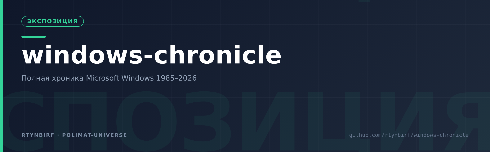

<div align="center">
  
</div>

# 🪟 Windows Chronicle (1985–2026)

Полная систематизированная хроника операционных систем Microsoft Windows: **все поколения за 41 год**, каталог болей пользователей, каталог активного продвижения и главный рейтинг «между двумя полюсами».

- **Составлено:** 31 октября 2026
- **Метод:** веб-верификация ключевых фактов (Microsoft Learn / Lifecycle, support.microsoft.com, StatCounter, BleepingComputer, Windows Central, PCMag, блог Windows Server); исторические даты сверены со справочными источниками. Всё, что не подтверждено напрямую, помечено словами «по сообщениям», «оценка», «≈».
- **Принцип:** ноль домыслов. Даты и события 2024–2026 гг. проверены по живым источникам, исторические — по общепринятым справочникам, спорные даты помечены явно.

## Структура репозитория

| Файл | Что внутри |
|---|---|
| `data/versions.csv` | Машинная таблица всех релизов: даты, семейства, сегменты, ядра, окончание поддержки — **77 записей**, релизы 1985-11-20 → 2026-09-29 (26H2), горизонты поддержки до 2034 |
| `data/timeline.csv` | Машинная хронология событий: дата; версия/событие; линия; примечание; теги — **41 запись**, 1985-11-20 → 2026-09 (релизы, служебные вехи вроде Patch Tuesday, метрики доли) |
| `data/pain-points.csv` | Машинный каталог болей пользователей: категория; подтема; период; суть; полярность (отрицательная = борьба); теги — **39 записей**, 1985–2026, категории A «Стабильность» … I «Безопасность» |
| `data/promotion.csv` | Машинный каталог продвижения: кампания/фича; период; суть; полярность (положительная = витрина); теги — **26 записей**, 1985 → 2026-03 |
| `data/two-poles.csv` | Машинная выжимка рейтинга «между двумя полюсами»: ранг; полярность; категория; тема; балл; теги — **40 записей** (ранги 1–40) |
| `01-history/chronology.md` | Хронология по 10 эпохам: 1983 → 2026, с ключевыми событиями каждой эпохи |
| `02-classification/classification.md` | Классификация: семейства ядер, линейки, сегменты, издания, каналы обновлений, кодовые имена |
| `03-user-pains/pains-by-era.md` | **С чем борются пользователи** — по эпохам, с датами конкретных инцидентов |
| `03-user-pains/pains-by-category.md` | Те же боли, сгруппированные по 18 категориям (сквозная картина) |
| `04-promotion/promotion.md` | **В чём активно продвигают**: лозунги, кампании, вечные промо-оси по эпохам |
| `05-two-poles/two-poles-ranking.md` | ⭐ **ГЛАВНОЕ:** нумерованный список «между двумя полюсами» (продвижение ↔ борьба), упорядоченный по релевантности |
| `05-two-poles/self-sufficiency-thesis.md` | Тезис «система самодостаточна, обновлять нечего»: доказательства (XP/7 без фич), цепь GWX → 1809 → 24H2, что в обновлениях реально нужно |
| `06-sources/sources.md` | Источники с URL, проверенные при составлении |
| `07-prototypes/three-architectures.md` | 🚀 Экстраполяция: три прототипа архитектуры «с нуля» по итогам 41 года — HELIOS (полюс −), SOVEREIGN (полюс +), SYMBION (золотая середина) |
| `08-anticenzor/README.md` | 🛠 Практика: PAC «Антицензор» — выборочная маршрутизация, человек=PID 1; сборщик + тесты + установка на Win10/11 |
| `data/chronicle.jsonld` | 🧬 Машинный таймлайн (П57): все 41 событие `data/timeline.csv` как schema.org/Event в `@graph` — датасет читается любым JSON-LD-парсером |
| `timeline.html` | 🖥 HTML-таймлайн, сгенерированный из JSON-LD скриптом `scripts/build_timeline.py` — детерминированная сборка (двойной прогон байт-в-байт идентичен), офлайн, без внешних ресурсов |

### Машинные данные и сборка (П57, issue #6)

Поток данных: `data/timeline.csv` (источник истины) → `data/chronicle.jsonld`
(schema.org) → `timeline.html` (визуализация).

```bash
python3 scripts/csv_to_jsonld.py            # CSV → JSON-LD (или --check на дрейф)
python3 scripts/build_timeline.py           # JSON-LD → timeline.html
python3 scripts/build_timeline.py --selftest
# PASS JSON-LD валиден (41 событие) · двойная сборка идентична ·
# событий в HTML == в JSON-LD
```

## Ключевые цифры (на момент составления)

- Первый релиз: **20.11.1985** (Windows 1.01); актуальная ветка: **Windows 11 26H2** (29.09.2026, enablement-пакет).
- **Windows 11 пересекла 1 млрд пользователей** (заявление Сатьи Наделлы в отчётности компании, начало 2026; за 1576 дней против 1705 дней у Windows 10).
- StatCounter, февраль 2026: Win11 ≈ **72,8 %**, Win10 ≈ **26,3 %**, Win7 < 1 % (в декабре 2025 было 50,7 % против 41–48 % — взрывной переток после конца Win10).
- Windows 10 22H2: конец поддержки **14.10.2025**; потребительский ESU — до **12.10.2027** (25.06.2026 Microsoft тихо продлила программу на второй год; бесплатно: 1000 баллов Rewards или синхронизация через Windows Backup; либо $30); корпоративный ESU — до 3 лет (до 2028).
- 19.07.2024: сбой обновления CrowdStrike вывалил в BSOD ≈ **8,5 млн Windows-устройств** (оценка Microsoft) — крупнейший каскадный инцидент в истории платформы.

## Дисклеймер

Даты окончания поддержки для 25H2/26H2 в таблице рассчитаны по стандартным 24-месячным (Home/Pro) циклам и помечены как расчётные; политика Microsoft может их менять. Часть кодовых имён (Nickel, Sun Valley) стала известна из утечек и не была официально подтверждена — это отмечено в тексте.
